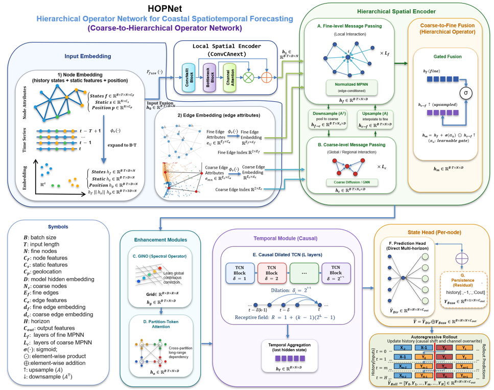

# HOPNet

**Hierarchical Operator-Partition Network for Multiscale Coastal State Forecasting**

The Hierarchical Operator-Partition Network for Multiscale Coastal State Forecasting (HOPNet) addresses single-dataset spatiotemporal forecasting through a modular architecture that combines complementary modeling components. These components include hierarchical graph message passing, global neural-operator and partition-attention corrections, causal temporal convolution, and a direct multi-horizon prediction head. Optional persistence residual learning enables the model to predict changes relative to a persistence baseline.

<picture>

</picture>

Test environment: Python 3.12.14, PyTorch 3.14, and CUDA 12.9.
Download the Harvey dataset and unzip:   https://drive.google.com/file/d/1d_acFI0CHsj2hxwFWX4UIweA-2XoOOgL/view?usp=sharing
Run for single GPU: python ddprun.py, parallel: torchrun --nproc_per_node=2 ddprun.py
